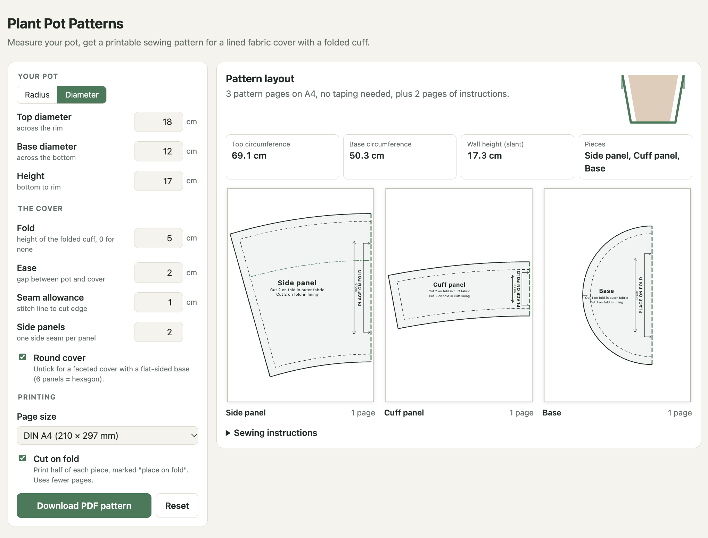

#  p3 - Plant Pot Patterns

A web app that generates printable PDF sewing patterns for a lined fabric plant pot cover with a folded cuff.
Everything runs in the browser: no backend.

**Use it: https://p3.andcake.dev/**



## Inputs

| Field | Default | Meaning |
|---|---|---|
| Measure as | diameter | Enter the top and base as a diameter or a radius. Switching converts the values. |
| Top | 18 cm | Diameter (or radius) of the top of the pot. |
| Base | 12 cm | Diameter (or radius) of the base of the pot. |
| Height | 17 cm | How tall the pot is. |
| Fold | 5 cm | Height of the folded cuff at the top. `0` means no cuff. |
| Seam allowance | 1.5 cm | Distance from the stitch line to the cut edge. |
| Ease | 2 cm | Gap between the pot wall and the cover, added to the radius. |
| Side panels | 2 | Number of side panels, which is also the number of side seams. |
| Round cover | on | Off gives a faceted cover with a regular polygon base (6 panels = hexagon, needs 3+ panels). |
| Cut on fold | off | Print only half of each piece, with a "place on fold" edge. All pieces are symmetric, so this roughly halves the paper. |
| Page size | DIN A4 | A4, A3, US Letter, US Legal, or A0 for a copy shop. |
| Printer scale | 100% | What your printer really produces. If the 10 cm test ruler prints as 9.8 cm, enter 98 and the pattern is enlarged to compensate. |

The settings are stored in the URL hash, so you can bookmark or share a pattern.

## What you get

The pattern has these pieces:

- **Side panel**: one section of the truncated cone, or a trapezoid for faceted covers. It has a line marking where the cuff ends.
- **Cuff panel**: the top `fold` cm of the wall. Its lower edge has 3 mm of extra room so it can hang over the outer shell. Because it is a separate piece, directional prints can run the right way up on both the cuff and the lining.
- **Base**: a circle, or a regular polygon whose inradius matches the pot.

Round covers with fewer than 4 panels have long curved seams. Their edges get extra matching notches, one about every eighth of the way round, so the cuff, side panels and base line up.

You cut each piece in outer fabric and again in lining. Every piece includes the seam allowance and has notches and a grainline arrow. On pieces cut on the fold, the grainline runs parallel to the fold.

The PDF contains:

1. An info page with a 10 cm test ruler and a 5 × 5 cm test square, your measurements, the cutting list and a page map.
2. Sewing instructions and a legend.
3. Pattern pages printed at 100% scale. Each piece gets its own page, so nothing needs taping. Pieces are turned to whatever angle and page orientation lets them fit, and their labels turn with them.
   - If all pieces fit on one sheet (A0), they share it.
   - A piece too big for any page is split over its own pages only. Those pages have labels like `Side panel A2` and half-diamond marks for joining, and the piece is shifted so its label stays clear of the joins.

## Printing at the right size

The PDF is drawn at exact size: the ruler is 100 mm and the square 50 mm in the file itself. It also asks PDF viewers not to scale when printing; Acrobat respects this. Some viewers and printer drivers still shrink the page slightly to fit the printer's margins, often to about 98%. Check the test square after printing. If it is off, either turn off "fit to page" / "scale to fit" in the print dialog, or enter the measured percentage as **Printer scale** and print again.

## Development

```sh
npm install
npm run dev       # http://localhost:5173
npm test          # geometry + layout tests (vitest)
npm run build     # type-check and build static site into dist/
```

Every push to `main` is tested, built and deployed to GitHub Pages by `.github/workflows/deploy.yml`.
The site is served at `p3.andcake.dev`:
- The custom domain is set in the repo's Pages settings.
- DNS is a `CNAME p3 → ipedrazas.github.io` record in Cloudflare. It must be set to "DNS only", or GitHub can't issue the HTTPS certificate.

| File | Role |
|---|---|
| `src/geometry.ts` | Validation and piece geometry: cone development, offsets, notches. All values in cm. |
| `src/layout.ts` | Places the pieces on pages: everything on one page, one piece per page (rotated to fit), or a tiled piece. |
| `src/marks.ts` | Geometry for the "place on fold" bracket at any angle. |
| `src/pdf.ts` | Draws the vector PDF with jsPDF. It is lazy-loaded when you click Download. |
| `src/preview.ts` | SVG previews of the sheet and a cross-section of the pot. |
| `src/instructions.ts` | Sewing steps, shared by the UI and the PDF. |
| `src/main.ts` | Form handling and URL state. |
